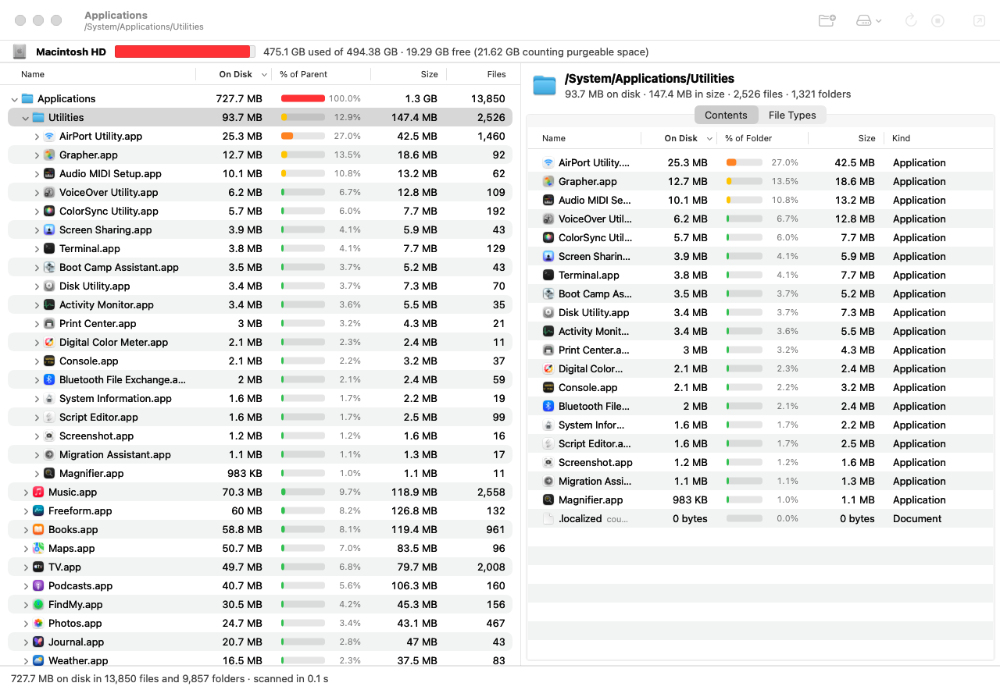

# FileTree

A simple macOS app that shows which folders take up space on your disk, in the spirit of
TreeSize Free and Folder Size for Windows.



## Features

- **Folder tree with sizes.** Folders are sorted by space on disk, largest first. Expand any
  folder to go deeper. The “% of Parent” bar shows a folder's share of its parent: green is small,
  yellow and orange are noticeable, red is more than half.
- **Columns:** On Disk (space taken on the disk), Size (logical size), Files, Folders, Last Modified
  (the newest change inside the folder). Folders and Last Modified are hidden at first. Right-click
  the column header to show or hide columns; click a header to sort.
- **Free space.** The bar at the top shows the volume, how full it is, the used and free space, and
  the space macOS can free up by itself (purgeable).
- **Contents tab.** Everything directly inside the selected folder: subfolders with their measured
  sizes, and files.
- **File Types tab.** Space by file type (extension) in the whole selected folder: number of files,
  space taken, average size, largest file.
- **Actions on folders and files:** Show in Finder, Open, Copy Path, Rescan This Folder (quickly
  recount one folder, for example after deleting something in the Finder), Scan Only This Folder.
- Fast multithreaded scanning: `/Applications` with 350,000 files takes about a second. Progress is
  shown while scanning, and Stop ends the scan and shows what has been counted so far.
- Scan a disk from the list, your home folder or any folder: with Choose Folder…, or by dropping a
  folder onto the window or onto the Dock icon.

## Download

The built installation packages are in the [`dist`](dist) folder of this repository. Open one of
them on GitHub and click the download button. Both hold the same app, which needs macOS 14 Sonoma or
later and runs natively on Apple silicon and Intel Macs:

- [`FileTree-1.0.dmg`](dist/FileTree-1.0.dmg) is a disk image: open it and drag FileTree onto the
  Applications folder next to it.
- [`FileTree-1.0.pkg`](dist/FileTree-1.0.pkg) is an installer that puts FileTree into the
  Applications folder.

### First launch

FileTree is not signed with an Apple Developer ID certificate, so macOS blocks it once:

- **Installer:** opening `FileTree-1.0.pkg` is refused at first. Open System Settings → Privacy &
  Security, scroll down to the message about the package and click **Open Anyway**, then go through
  the installer. The installed app opens normally.
- **Disk image:** after copying FileTree to Applications, open it. macOS says it cannot verify the
  app; click Done (or OK). Then click **Open Anyway** in System Settings → Privacy & Security and
  confirm with your password or Touch ID.

From then on FileTree opens normally. On macOS 14 you can instead right-click the package or the
app and choose Open. For the app the same can be done in Terminal:

```bash
xattr -dr com.apple.quarantine /Applications/FileTree.app
```

## Full Disk Access

macOS keeps apps out of some folders: Mail, Messages, Safari, the containers of other apps. Without
permission FileTree shows such folders with ⚠︎ and the note “protected by macOS”, and their size
is not included in the total. macOS also asks once for access to the Desktop, Documents and
Downloads folders.

To measure everything:
1. Put FileTree in the Applications folder (when building from source: `make install`).
2. Open System Settings → Privacy & Security → Full Disk Access. The Open Full Disk Access
   Settings… button in FileTree opens this page.
3. Click + below the list (macOS asks for your password or Touch ID), choose
   `/Applications/FileTree.app`, make sure its switch is on, and restart FileTree.

FileTree is signed ad hoc, without a developer certificate, so macOS treats every new version
(a new release or a rebuild) as a different app and the permission has to be given again: remove
the old FileTree entry with − and add the app again. If you have a certificate, build with
`make install SIGN_IDENTITY="Apple Development: …"` and the permission survives rebuilds.

Folders marked “no permission” belong to the system (root) or to another user, for example part
of `/private/var/db`. Full Disk Access does not open them. They are usually small.

## How sizes are counted

- **On Disk** is the space the files really take on the disk (allocated blocks). This is the
  column that shows what ate your disk space. **Size** is the logical size, the one the Finder
  shows. A sparse 1.5 GB disk image with almost nothing written to it has a large Size and almost
  no On Disk.
- Data shared by several files is counted once, in the first folder where the scan met it. These
  are files with several hard links and full APFS clones (copies made in the Finder on the same
  disk share the same blocks). In Contents such files are marked “clone” or “counted in …”.
  Deleting one copy of a clone frees almost nothing. If you delete the copy in which the data was
  counted and click Rescan This Folder, the data is counted in a remaining copy.
- Symbolic links are not followed: only the link itself is counted.
- When “Macintosh HD” is scanned, the folders of the data volume (`/Users`, `/Applications`,
  `/Library` and so on) are counted once, in their usual places, without the copy inside
  `/System/Volumes/Data`. Service volumes of the same disk (VM with the swap files, Preboot) are
  included because they share its free space. Other disks, disk images and network shares inside
  the scanned folder are not scanned: they are marked “other volume”.
- In the Preboot volume macOS shows, in the `Cryptexes` folder, the contents of cryptexes: signed
  disk images with part of the system, mostly the shared cache of system libraries. The images
  themselves are files in the `cryptex1` folder of the same volume, and they are counted there. So
  when the whole of Preboot is scanned (for example together with “Macintosh HD”), the `Cryptexes`
  folder is marked “disk images of macOS, counted in cryptex1” and is not counted a second time.
  To look inside it, use Scan Only This Folder. `du` counts this content as ordinary files and
  shows more for Preboot than is used; compare with `diskutil info /System/Volumes/Preboot`
  (the Volume Used Space line) instead.
- iCloud files and folders that were removed from the Mac take almost no space on the disk and are
  counted that way. Scanning does not download them. Such folders are marked “in iCloud, not
  downloaded”.
- FileTree reads the table of mounted volumes once, without asking the volumes themselves, so an
  unreachable network share cannot hang the scan.

### What the tree does not show

- Local Time Machine snapshots and APFS snapshots. The command `tmutil listlocalsnapshots /`
  lists them.
- Partly shared APFS blocks: clones that were changed later. Such files are counted in full, as
  `du` and the Finder do.
- That is why the total in the tree can differ from the used space in the volume bar.

## Keyboard shortcuts

| Keys | Action |
|---|---|
| ⌘O | Choose a folder |
| ⇧⌘H | Scan the home folder |
| ⌘R / ⇧⌘R | Rescan everything / the selected folder |
| ⌘. | Stop the scan |
| ⌥⌘R | Show in Finder |
| ⌘↓ | Open |
| ⌘C | Copy path |
| ⌘1 / ⌘2 | Contents / File Types tab |
| Double-click | In the tree: expand or collapse; in Contents: go into the folder or show the file in the Finder |

## Building from source

You need macOS 14 or later and the Command Line Tools (`xcode-select --install`) or Xcode.

```bash
make            # builds build.noindex/FileTree.app
make run        # builds and opens it
make install    # copies it to /Applications (another folder: make install INSTALL_DIR=~/Applications)
make test       # runs the tests
make release    # builds the universal app (Apple silicon and Intel) and the packages in dist/
make clean      # removes the build files (.build, about 500 MB) and build.noindex/
```

The build goes into a folder whose name ends in `.noindex`: Spotlight skips such folders, so
Spotlight and Apps show only the copy installed in `/Applications`.

## Development

- `Sources/FileTreeCore` is the engine without a user interface: reading folders with
  `getattrlistbulk`, parallel traversal, the volume rules (`ScanBoundary`), counting hard links and
  clones, statistics by file type. The tests are in `Tests/FileTreeCoreTests`.
- `Sources/FileTree` is the AppKit app.
- `FileTree --benchmark <folder> [--depth N] [--threads N] [--exclude <folder>]` scans without a
  window and prints the time and the largest folders.
- `FileTree <folder> --snapshot <directory> [--select <folder>] [--stop-after <seconds>]` drives the
  window with nobody at the screen (the window stays invisible) and saves screenshots as PNG files.
- `make icon` redraws the icon (`Scripts/make_icon.swift`).

## License

FileTree is free software, released under the GNU General Public License v3.0. See
[LICENSE](LICENSE).

Copyright © 2026 muchachogonzalis
